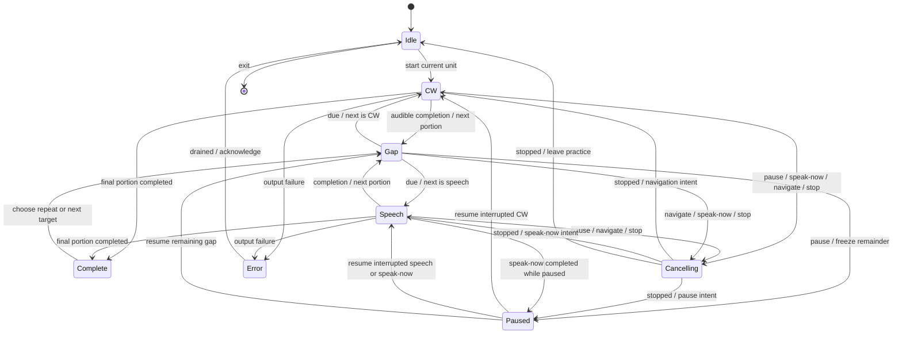

# Playback and storage architecture

Ticket 00 design, 2026-10-16. User-approved approach. Ticket 01 software is implemented;
[verification evidence](skeleton-verification.md) distinguishes completed checks
from outstanding listening acceptance.
See [terminal UI](terminal-ui.md) for behavior and
[skeleton acceptance](skeleton-acceptance.md) for the first executable slice.

## Stack decision

Use Go, Bubble Tea v2 for the terminal, Oto v3 for PCM output, `/usr/bin/say`
for speech, and a versioned JSON library. This keeps the app in one language
with native speech provided by the host. Use Go's standard test tooling; add
no database, framework around the session, or plugin architecture.

Bubble Tea offers message-driven update/view handling and commands for work
outside the UI loop. Use `charm.land/bubbletea/v2`, including its v2 key/view
interfaces. Add Bubbles text inputs only if the editor needs them; do not
create editors from scratch merely to avoid a small established dependency.
[Primary documentation](https://pkg.go.dev/charm.land/bubbletea/v2),
[v2 migration guide](https://github.com/charmbracelet/bubbletea/blob/main/UPGRADE_GUIDE_V2.md).

Oto supplies PCM players, pause/seek, and buffer controls. Its docs require one
context, distinguish read-ahead from playback, and describe hardware latency;
`Close` is deprecated and is not a stop operation. Use one context and at most
one playing CW player. Stop through `PauseAndStopReading`, then discard or seek
the source before reuse. Do not assume EOF or bytes read means audible completion.
[Primary Oto documentation](https://pkg.go.dev/github.com/ebitengine/oto/v3).

The installed macOS `say(1)` manual confirms speech through system-selected
output and stdin input (`-f -`). Invoke the absolute executable with fixed args
and plain phrase bytes on stdin. Capture errors privately; do not render speech
text in hidden-mode errors. Go's subprocess interface avoids shell evaluation
and provides process cancellation/waiting.
[Go subprocess documentation](https://pkg.go.dev/os/exec).

Alternative considered: Swift with native audio/speech. It provides direct
Apple integration but adds terminal work and language-specific tooling for a
CLI whose non-audio needs fit Go. Choose Go provisionally; revisit the audio
adapter only if skeleton cancellation/latency fails. Do not implement two stacks.

Local read-only checks found Go 1.26.5 on darwin/arm64, macOS 26.6.2, `/usr/bin/say`,
and SDK 26.5. These are observed development conditions, not supported minimums.
Ticket 01 must pin compatible released dependency versions in its module files
and establish a tested macOS/architecture baseline. Oto docs reviewed were
v3.5.1, which has `PauseAndStopReading`; verify the actual pinned version's API.
Ticket 01 pins Bubble Tea v2.1.0 and Oto v3.5.1. See the verification record for tested conditions; no cross-platform support is claimed.

## Modules and ownership

| Module | Responsibility | Small interface |
| --- | --- | --- |
| Terminal | Focus, editing, rendering, translating keys to actions | Send session actions; display snapshots |
| Practice session | Current selection, unit/portion/counts, timing changes, cancellation, sequence | Dispatch actions/events; return snapshot and effects |
| Morse | Validate/encode supported tokens; produce timed elements and display markers | Compile text + settings into a timeline |
| Output | Render timeline as PCM or run speech; report progress/completion/stopped/error | Start, stop, report events tagged with operation ID |
| Library store | Validate/load/save versioned data | Load and save library |

These are responsibilities, not a demand for a package per row or interfaces
around every function. Use adapters only where real Mac and deterministic test
implementations differ. Keep the external test seam at the practice session;
check rendering/storage through their observable output as agreed in the spec.

The session is the sole policy owner. A serialized event loop accepts UI
commands and output/timer events. It creates immutable snapshots for the TUI;
workers never mutate selection or counters. Long-running output, save, and stop
work runs outside both session and terminal event processing. Serialize saves
by revision so an older completion cannot mark newer edits saved.

Every output operation and gap timer gets a monotonic generation ID. Cancellation
invalidates its ordinary progress/done events immediately. A separate stop
acknowledgment still clears the cancellation barrier. Launch the next output
only after the previous output worker has stopped, speech has been waited/reaped,
and the output adapter has satisfied its bounded drain policy. Coalesce rapid
navigation to the last selected target. Exit takes precedence over pending starts.

The diagram shows major paths; the transition rules in the UI design are
normative. Cancelling can start a gap or remain paused depending on its saved
continuation. Any active state can stop/exit or fail; failures cancel/drain first
before recovery. A fatal context error permits only library access or exit until
restart. Zero-length gaps enqueue a new event instead of recursively spinning.

Pause discards partial CW/speech progress and remembers the portion's initial
count/state. Resume restarts that portion; completed portions remain counted.
A user-initiated speak-now instead resets the entire unit. Interruption cannot
increment a count because only the active operation's completion is accepted.

## Timing and audio

Compile Morse into a sample-index timeline, including mark/space and text-token
markers. Generate 48 kHz mono float32 PCM on demand from a bounded, seekable
reader; do not preallocate audio for arbitrarily long phrases. Use a fixed modest
amplitude and short attack/release ramps contained inside each mark. Candidate
ramp: 3 ms, bounded by half the mark. No envelope extension changes duration.

Character timing and extended spacing follow the PARIS-based Farnsworth rule.
At character rate c and overall rate w, dit = 1.2/c seconds; total spacing per
PARIS is 60/w − 31×dit, split into 19 spacing units. Inter-character spacing is
three of those units; inter-word spacing seven. At 20/15, dit = 60 ms,
character gap ≈337.895 ms and word gap ≈788.421 ms. The calibration PARIS plus
trailing word gap is four seconds. [ARRL timing reference](https://www.arrl.org/files/file/Technology/x9004008.pdf).
Standard element ratios and encoding use [ITU-R M.1677](https://www.itu.int/rec/R-REC-M.1677-1-200910-I).

Use cumulative fractional sample rounding to avoid long-message drift. Prosigns
join their elements with intra-character spacing only. A practice rendering ends
at the final mark; no trailing Morse word gap is added before the separate
practice pause. The calibration test explicitly requests the trailing word gap.

Progress reports estimate consumed samples from reader position minus queued
player bytes, then account for the configured hardware queue estimate. Mark this
as estimated, not a hardware playhead. UI progress derives from these timeline
indices, never a second Morse scheduler. Use monotonic time only for session gaps
and output polling, with fake time in tests. Hardware/OS buffering is the primary
unproven risk; skeleton checks completion/stop tails before highlighting is built.

The output adapter owns completion and cancellation drain detection. After source
EOF, wait for the player to finish and the conservative hardware-tail estimate
before reporting Done. On cancellation, pause/stop reading and wait that tail
before acknowledging Stopped; no speech/new tone begins earlier. Configure bounded
buffers and validate a ≤100 ms audible stop target on the local built-in/wired
output. Bluetooth latency is not assumed equivalent. If no reliable bound can be
established, ticket 01 must revisit the adapter, not conceal uncertainty with UI
timers. Command receipt should remain responsive during the drain.

Speed/tone updates build a new timeline at the next CW start, including after a
restart. The in-flight timeline is immutable. A 2 s gap starts only after output
completion, not at source EOF. Keep amplitude, speech rate, and voice as fixed
implementation defaults initially; speech rate is independent of CW WPM.

## Saved model and durability

Use one JSON document under `os.UserConfigDir()/cw-looper/library.json` (on this
Mac, `~/Library/Application Support/cw-looper/library.json`). Version 1 contains:

| Record | Fields/invariants |
| --- | --- |
| Library | schemaVersion, seedVersion, ordered lists; unique stable IDs |
| List | id, name, ordered entries, settings |
| Entry | id, kind=item or exchange; item has CW text + optional spoken override; exchange has title + ordered lines |
| Line | id, station=learner or other, CW text, optional spoken override |
| Settings | character/overall WPM, learner/other Hz, pause seconds, style, display, sequence, line advancement, speech interval |

An ordinary item uses learner tone. Null spoken override means generated; a
nonempty override is retained through CW edits. Empty/whitespace-only input is
invalid, including an explicitly empty spoken override. Do not persist playback
position, reveal state, current counters, pending output, or paused state.
The skeleton can store this shape with fixed settings and explicit spoken text;
future fields do not require future feature implementation.

Acquire a nonblocking exclusive file lock for the session; a second app reports
that this library is already open, preventing lost updates. Save a validated
snapshot by writing a same-directory private temporary file, syncing/closing it,
then renaming it over the library and syncing the directory on macOS. Treat
errors at any stage as unsaved; retain the in-memory revision for retry. Do not
leave unbounded temporary files. The standard library provides configuration
paths and file operations; the save sequence is our design choice.
[Go os documentation](https://pkg.go.dev/os/).

Seed only when the library file is absent. An existing empty library is valid.
Malformed data, unsupported future schemas, and permission errors never trigger
seeding. Validate IDs, kinds, ranges, tokens, and required fields before playing
or writing; show a recovery error and preserve the file. Migration must be
explicit; keep the original before replacing a prior schema. No migration system
or updater is needed in ticket 01. Starter-library installation in ticket 09
must account for the skeleton seedVersion without overwriting practice data.

## Decisions to validate, not promises

1. Oto stop/drain and progress estimates are accurate enough for this device.
2. Killing and waiting for `say` promptly stops audible speech, including OS tails.
3. Both outputs consistently use the chosen Mac output. Initial support is the
   selected output at session start; hot device switching may require restart.
4. The selected dependencies build with pinned versions on this Mac.
5. Long text cannot block input or allocate unbounded PCM; the timeline and
   input length limits must be bounded in the skeleton implementation.

Failure of these checks reopens the relevant choice in this document. No
alternative plan or speculative second backend should be built in advance.
